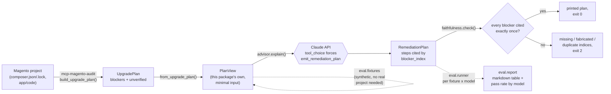

# magento-upgrade-advisor

[](https://github.com/michalper/magento-upgrade-advisor/actions/workflows/ci.yml)
[](LICENSE)
[](pyproject.toml)
[](https://github.com/astral-sh/ruff)

An LLM reasoning layer over [`mcp-magento-audit`](https://github.com/michalper/mcp-magento-audit)'s
structured upgrade-plan output: turns a list of blockers into a prioritized, human-readable
remediation plan, with a **programmatic faithfulness check** and a **model-comparison eval
harness** — not a demo that "looks right", one that's actually checked.

> **Status: early stage.** Built on evenings/weekends. Prompt construction, response parsing and
> the faithfulness check are verified against a stubbed client (98% test coverage, `ruff`/`mypy
> --strict`/`bandit`/`pip-audit` all clean) — a live run against the real Anthropic API, and a real
> `docs/eval-report.md`, need `ANTHROPIC_API_KEY` set and haven't been recorded yet.

## Data flow



The eval harness (dashed edges) runs the same `explain` → `faithfulness.check` path as a real
`explain` call, just against `eval/fixtures.py`'s synthetic `PlanView`s instead of a live project —
so the harness is exercising the actual production code path, not a separate test-only copy of it.

## The problem this solves

`mcp-magento-audit`'s `build_upgrade_plan` tool returns a precise but mechanical answer: a list of
`Blocker(source, description, detail)` tuples — exactly what blocks an upgrade, nothing more. That's
correct and intentional (see that project's own README), but it's not what a human wants to read
before starting a 50-store Magento upgrade: *which blocker first, and why, in plain language.*

Handing that list to an LLM and asking for a narrative is the obvious next step — and also the
obvious way to quietly drop a blocker the model found boring, or invent one that sounds plausible.
This project exists to make "did the model actually account for every blocker, truthfully" a
checkable fact, not a feeling.

## How faithfulness is checked — not by asking another LLM

The model is asked to cite each blocker **by its index** in the input list, not to restate it in
its own words. That turns "did the output account for every real blocker, and nothing else" into
a set-equality check on integers:

- **missing** — a real blocker index never cited
- **fabricated** — a cited index that doesn't correspond to any real blocker
- **duplicate** — a real blocker cited more than once

No fuzzy string matching against a paraphrase, no second model call to "judge" the first one's
output (which just moves the hallucination risk one level up, see
[`mcp-job-search`](https://github.com/michalper/mcp-job-search)'s anti-fabrication linter for the
same philosophy applied to CV drafting). `src/magento_upgrade_advisor/faithfulness.py` is the
entire check, in about 20 lines.

## Eval harness

`magento-upgrade-advisor eval` runs every synthetic fixture in
`src/magento_upgrade_advisor/eval/fixtures.py` (zero blockers, a single blocker, mixed-source
blockers, blockers alongside `unverified` signals, and a deliberately long list to see whether a
model starts dropping or merging under load) against every model given to it, and reports
faithfulness + token usage + latency per run as a markdown table. See
[`docs/eval-report.md`](docs/eval-report.md) — a placeholder until a real `ANTHROPIC_API_KEY` run
records it.

## Install

```bash
pip install magento-upgrade-advisor
export ANTHROPIC_API_KEY=sk-ant-...
```

A **user-scoped** key (one created against your account rather than a specific workspace — the
Anthropic Console marks these `Scope: Organization`) gets a 400 ("not scoped to a workspace")
unless you also set:

```bash
export ANTHROPIC_WORKSPACE_ID=wrkspc_...   # Console → Organization settings → Workspaces → your workspace's ID
```

A key already scoped to one workspace doesn't need this.

## Use

```bash
# explain a real project's upgrade plan
magento-upgrade-advisor explain /path/to/magento/project \
  --target-php 8.3 --target-magento 2.4.7

# run the eval harness (default: claude-haiku-5-5 + claude-sonnet-5-5)
magento-upgrade-advisor eval --out docs/eval-report.md
```

`explain` exits non-zero if the faithfulness check fails, with the specific missing/fabricated/
duplicate indices printed to stderr — a CI-friendly, non-silent failure mode rather than printing
a plausible-looking answer and moving on.

## What this doesn't pretend to be

It doesn't re-run `mcp-magento-audit`'s own checks (phpcs/phpstan/rector/composer audit) — it
reasons over whatever that project already found, nothing more. It doesn't choose a model for
you: `eval` exists precisely because "which model is both faithful and cheap enough for this"
is an empirical question, not something to assume from a model's general reputation.

## License

MIT — see [`LICENSE`](LICENSE).
